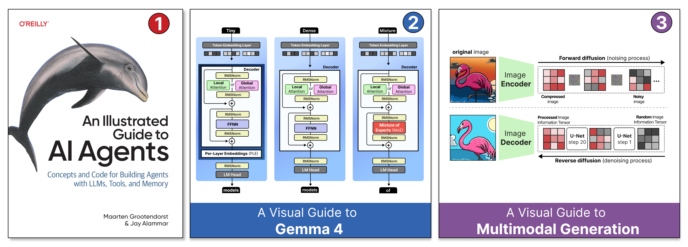

# Bonus Material

With the incredible growth of AI Agents in recent years, capturing everything in a single book is near impossible. That does not mean we should stop trying!

We decided to cover the fundamentals of AI Agents in the book, from LLMs and reasoning to memory, tools, and planning. Using the book as a starting point, we continue creating visual guides that explore certain topics in-depth that could not be covered that way in the book.

All bonus materials enhance the book through the same visual and illustrative style. Because you are already familiar with our illustrative styles, exploring these additional topics should be a breeze!

To get a feeling of each guide, click its title for a short description of what it is about, or go directly to the full article:

| Visual Guide | What you will explore | Extends |
|---|---|---|
| [A Visual Guide to Gemma 4](gemma-4.md) [Read the full guide](https://newsletter.maartengrootendorst.com/p/a-visual-guide-to-gemma-4) | The Gemma 4 architectures, their efficiency tricks, and how they understand images and audio | [Chapter 2: Large Language Models](../chapter02/) and [Chapter 9: Multimodal Understanding](../chapter09/) |
| [A Visual Guide to Multimodal Generation](multimodal-generation.md) [Read the full guide](https://newsletter.maartengrootendorst.com/p/a-visual-guide-to-multimodal-generation) | Generating images, audio, and video, and bringing these capabilities to Multimodal LLMs | [Chapter 9: Multimodal Understanding](../chapter09/) |
