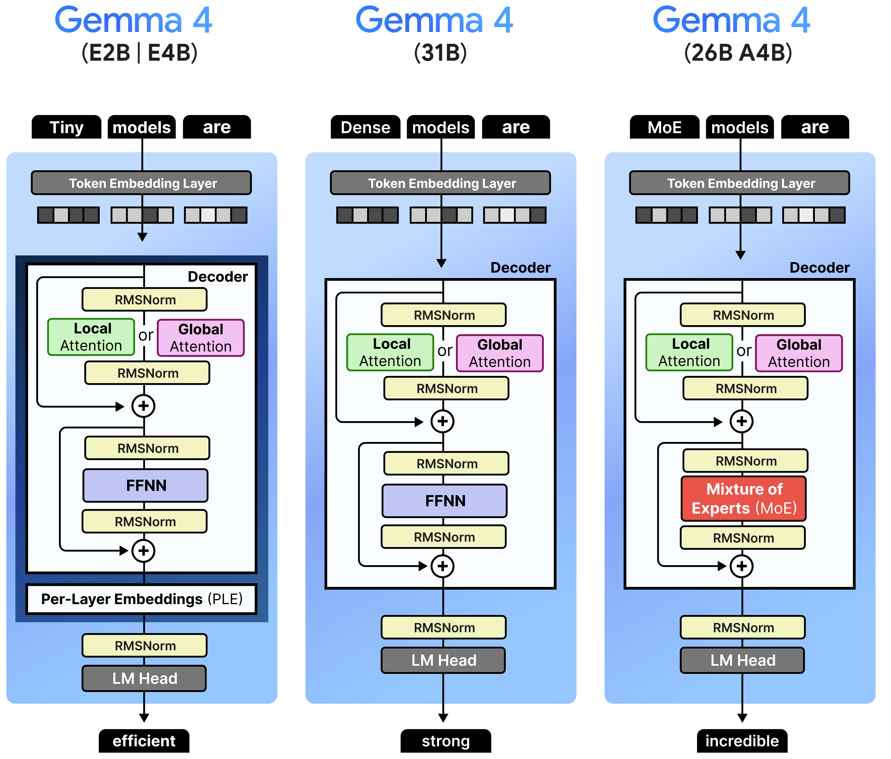
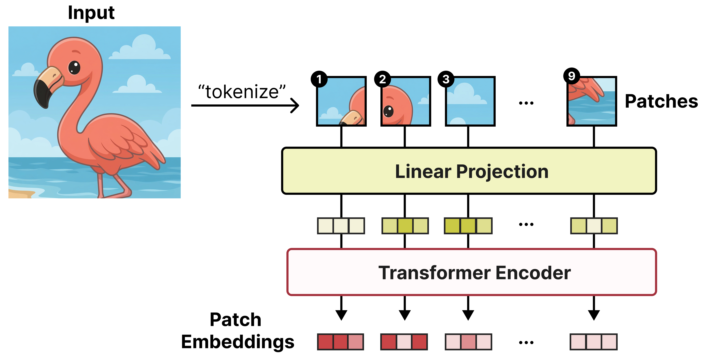

# [A Visual Guide to Gemma 4](https://newsletter.maartengrootendorst.com/p/a-visual-guide-to-gemma-4) (Extends Chapters 2 and 9)

In Chapter 2, we explore how Large Language Models work and start using Gemma 4 to build our `TinyAgent` from scratch. In Chapter 9, we extend our Agent with multimodal understanding, allowing it to process images alongside text.

But there is much more to explore about the models we use throughout the book. What makes the smaller Gemma 4 models efficient, and how do their architectures differ from the larger models?

[A Visual Guide to Gemma 4](https://newsletter.maartengrootendorst.com/p/a-visual-guide-to-gemma-4) explores these architectures in the highly visual way that you can expect having read the book. It covers local and global attention, Mixture of Experts, and the per-layer embeddings used in the smaller models.

It further illustrates how Gemma 4 understands images and how the smaller models process audio, showing how the vision and audio encoders create embeddings that the LLM can process.

The book focuses on building Agents with these models. The illustrated guide complements Chapters 2 and 9 by exploring their inner workings, including how Multi-Token Prediction (MTP) can speed up generation.
