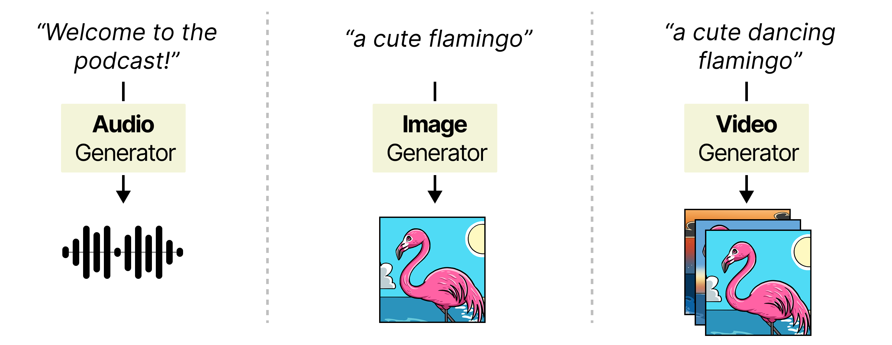
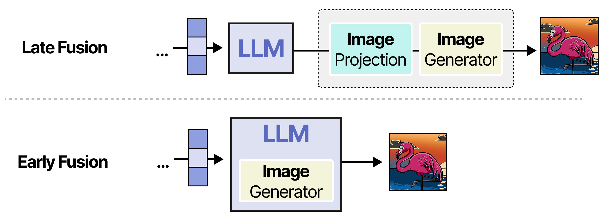

# [A Visual Guide to Multimodal Generation](https://newsletter.maartengrootendorst.com/p/a-visual-guide-to-multimodal-generation) (Extends Chapter 9)

In Chapter 9, we explore how LLMs can understand images, audio, and video. We showcase how these multimodal capabilities allow our Agent to process images alongside text.

But understanding these modalities is only part of the story. How can we make LLMs generate images, audio, and video themselves?

[A Visual Guide to Multimodal Generation](https://newsletter.maartengrootendorst.com/p/a-visual-guide-to-multimodal-generation) explores these generative capabilities through more than 50 custom visuals. It covers Stable Diffusion and Diffusion Transformers for image generation, AudioLM for audio generation, and how diffusion can be extended to generate videos.

It further illustrates how these generators can be connected to LLMs (late fusion), or how the architecture of the LLM itself can be updated to generate multiple modalities (early fusion), with examples like NExT-GPT and Janus.

This guide was originally a chapter of the book, but we created just too many visuals! Released as a free bonus chapter, it complements Chapter 9 by extending multimodal understanding to multimodal generation.
